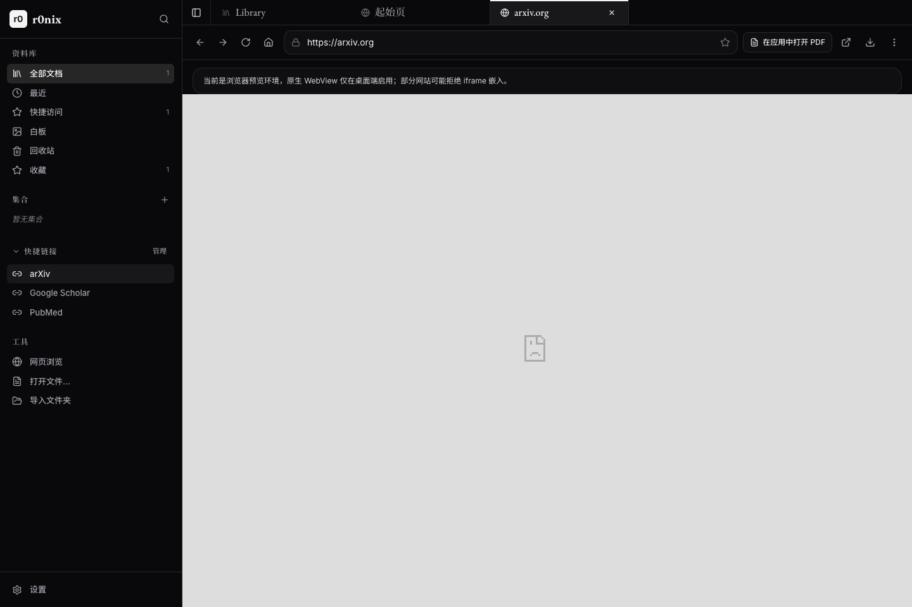
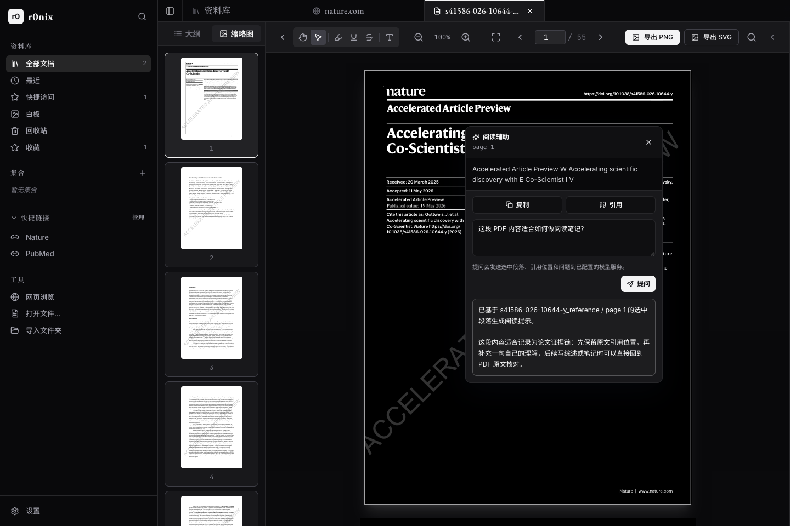

<h1>
  
  r0nix
</h1>

把读论文这件事，放回一个安静的桌面。

r0nix 是一个面向科研阅读的本地桌面应用：打开 PDF，顺手查网页，摘录段落，导出图像，整理笔记和白板线索，都在同一个工作区里完成。它不想替代文献管理器，也不想变成另一个臃肿浏览器；它只专注一件事：让论文阅读少切窗口、少丢上下文。



## ✦ 为什么会需要它

读一篇论文常常不是“打开 PDF”这么简单。

论文阅读常常会从网页跳到 PDF，从图表跳到笔记，从参考文献跳到搜索页面；看到重要段落时需要复制、引用、提问；看到好图时需要干净地导出；读到一半还希望下次回来能接着看。r0nix 把这些动作收在一个轻量工作台里，让阅读过程更连续。

## ✨ 亮点

- 📄 **PDF 和网页并排工作**：在应用里打开论文网页、搜索页面和 PDF 链接，不必频繁跳出当前阅读流。
- 🪄 **段落级阅读辅助**：选中 PDF 或 Markdown 里的段落后，可以复制、引用，或发送给已配置的模型服务提问。
- 🖼️ **图像导出更直接**：从 PDF 页面导出 `SVG`、`PNG`，方便保存图表、方法示意和阅读材料。
- 🗂️ **资料库不打扰**：最近阅读、收藏、集合、回收站和快捷链接都在侧边栏，够用但不喧宾夺主。
- 🧩 **白板整理线索**：把论文、概念和临时想法放到白板上，适合综述、开题和多篇文章对照阅读。
- 🔒 **本地优先**：阅读状态、资料库和设置保存在本机，不需要账号。

## 🧭 典型工作流

1. 从资料库打开本地 PDF 或 Markdown。
2. 在网页标签页搜索论文、打开期刊页面或访问常用学术网站。
3. 遇到 PDF 链接时，直接拉回应用内阅读。
4. 阅读时标注重点、记录笔记、复制引用段落。
5. 需要图表时导出图片，需要整理思路时丢到白板。
6. 下次打开时，从最近阅读和进度继续。



## ⬇️ 下载

在 GitHub Releases 下载对应平台安装包：

- Windows：`.exe` 或 `.msi`
- macOS：`.dmg`

安装后启动 `r0nix`。当前版本为 `0.0.6`。macOS 在配置 Developer ID 签名和 Apple 公证凭据时会发布正式签名包；缺少这些凭据时，Release 会生成 ad-hoc 签名的可用 DMG，首次打开可能需要在 macOS“隐私与安全性”里手动允许。

## 🔐 阅读辅助和隐私

r0nix 默认以本地阅读为中心，不需要登录账号，也不会默认上传 PDF。

阅读辅助是可选功能：只有在设置里填写 HTTP(S) 模型服务地址，并主动对选中段落提问时，应用才会发送这段文本、引用位置和问题。未配置模型服务时，r0nix 仍然可以作为普通阅读和整理工具使用。

## 🛠️ 给开发者

项目基于 Tauri、React、Rust 和嵌入式 Python/PyMuPDF 运行时。前端负责阅读界面、资料库、网页标签和设置；Rust 侧负责本地文件、桌面能力、PDF 桥接和原生 WebView。开发时建议先启动前端，再按需要启动 Tauri 桌面壳。

安装依赖：

```bash
npm install
```

启动前端开发服务器：

```bash
npm run dev
```

启动桌面应用：

```bash
npm run tauri dev
```

运行本地验证：

```bash
npm run verify
```

`npm run verify` 会执行前端构建、发布配置检查和浏览器级 UI smoke。涉及 Rust/Tauri、原生命令、权限或桌面壳时，继续运行：

```bash
cargo test --manifest-path src-tauri/Cargo.toml --lib
cargo check --manifest-path src-tauri/Cargo.toml
npm run tauri -- build --no-bundle
```

涉及发布配置、CSP、capability 或安装器资源时，运行：

```bash
npm run check:release
```

发布 macOS 安装包前，GitHub 仓库需要配置这些 Secrets：

- `APPLE_CERTIFICATE`
- `APPLE_CERTIFICATE_PASSWORD`
- `APPLE_SIGNING_IDENTITY`
- `APPLE_ID`
- `APPLE_PASSWORD`
- `APPLE_TEAM_ID`

缺少这些签名和公证凭据时，release workflow 会改用 ad-hoc signing 打出 macOS DMG。这个包可以用于测试和临时分发，但不等同于 Developer ID 公证包；面向普通用户稳定分发前，应补齐上述 Secrets 后重新发布。
